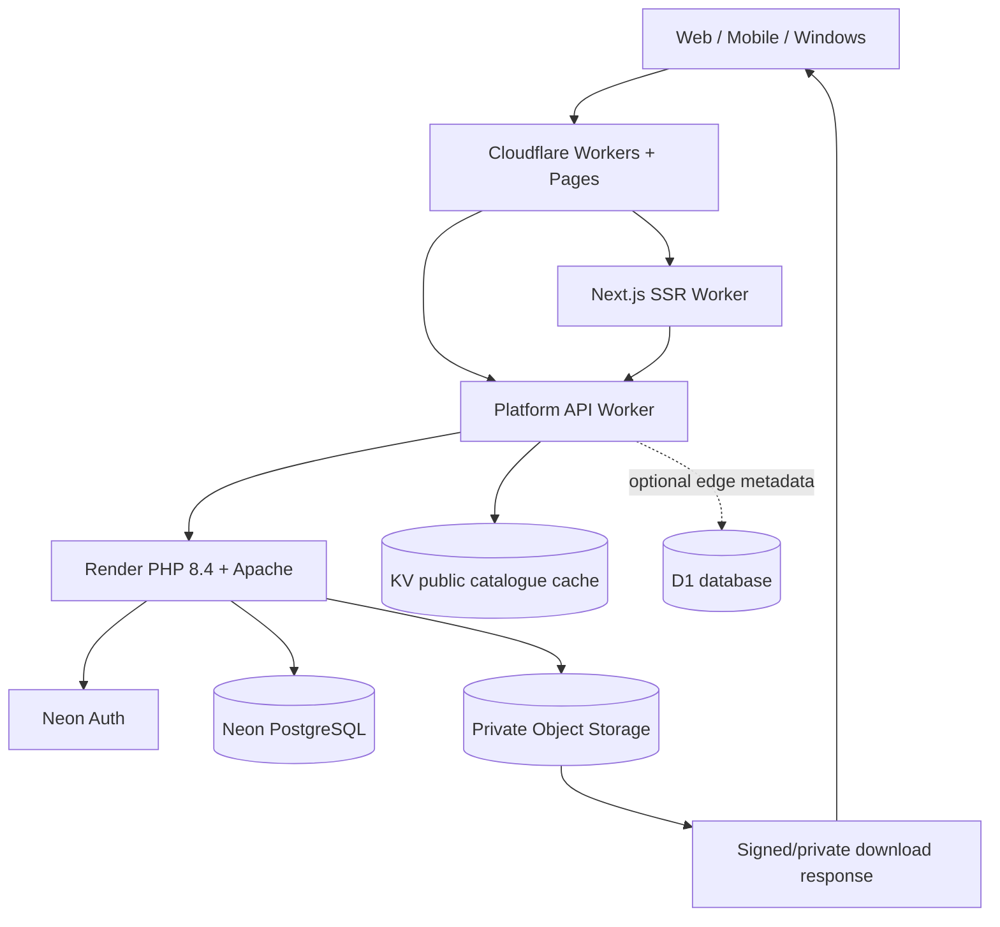

# HendyStore — kiến trúc Cloudflare + Render + Neon

## Nguồn dữ liệu và trạng thái hiện tại

| Lớp | Vai trò | Trạng thái đã xác minh |
|---|---|---|
| Render Web Service | PHP 8.4 + Apache, API nghiệp vụ và Admin | Production origin tại `https://hendystore.onrender.com` |
| Neon PostgreSQL | Tài khoản, ứng dụng, phiên bản, release, thư viện và lịch sử tải | Project `sparkling-grass-08962862`, branch `production`, database `Hendy_Store` |
| Neon Auth | Identity/JWKS và đăng nhập | Dùng bởi PHP/browser integration |
| Object Storage | Package và media riêng tư | Adapter Neon/CloudFly/R2/S3; phải có bucket private và HeadBucket pass trước khi đổi provider |
| Cloudflare account | Workers, Pages, R2, D1, KV, Queues | Tài khoản đã kết nối; chưa có Zone/domain tùy chỉnh |
| Next.js Storefront | SSR, SEO, metadata ứng dụng | Build Next.js và OpenNext đã pass CI; chưa xác nhận deploy production |

Neon là nguồn dữ liệu canonical. Không tạo bản ghi người dùng, sản phẩm, đơn hàng hay lịch sử tải thứ hai tại D1. Không bật dual-write.

## Luồng production

### Quyền sở hữu nghiệp vụ

- PHP trên Render giữ xác thực, phân quyền, CSRF, Admin, nhà phát triển, kiểm duyệt, thư viện và download grant.
- Neon PostgreSQL giữ dữ liệu nghiệp vụ và session.
- Cloudflare Worker là edge adapter/proxy; nó chuyển tiếp cookies, Authorization và CSRF tới PHP, không bỏ qua kiểm tra quyền.
- Next.js gọi cùng API origin. Route API là same-origin proxy để tránh lộ secrets.
- Cloudflare Pages phục vụ static assets và Pages Functions/Advanced Mode proxy. PHP không chạy trực tiếp trên Pages hoặc Workers.
- `workers.dev` và `pages.dev` có thể dùng khi chưa có Zone. Custom domain chỉ cấu hình sau khi tài khoản có Zone đang hoạt động và DNS thuộc quyền kiểm soát.

## Database adapters — origin and D1

### `origin` — mặc định production

Worker gọi `HENDY_API_ORIGIN=https://hendystore.onrender.com`. Neon credentials chỉ nằm ở Render. Đây là chế độ production được chọn.

### D1 — dữ liệu edge tách biệt

Worker dùng binding `DB` và truy vấn native SQLite/D1. D1 độc lập với Neon:
- Dùng cho cache metadata hoặc workload edge có schema riêng.
- Chạy `SELECT 1` để kiểm tra binding.
- Không tự sao chép schema hoặc rows từ Neon.
- Không chuyển `DATABASE_PROVIDER` sang D1 cho API nghiệp vụ hiện có.

Worker chỉ dùng HTTPS origin hoặc native D1 binding. Neon PostgreSQL giữ vai trò cơ sở dữ liệu nghiệp vụ.

## Object Storage

| Provider | Endpoint/region | Vai trò |
|---|---|---|
| Neon | Existing S3 endpoint and credentials | Legacy read fallback trong quá trình chuyển |
| CloudFly | `https://s3.cloudfly.vn` / `hn` | S3-compatible provider |
| Cloudflare R2 | `https://<ACCOUNT_ID>.r2.cloudflarestorage.com` / `auto` | Kho object ưu tiên sau khi xác minh private access |
| Generic S3 | Endpoint/region do admin cấu hình | Provider tương thích S3 |

Quy tắc chuyển:
1. Bucket mới phải private, public access off, CORS chỉ cấp PUT cho đúng Storefront origin.
2. Xác thực `HeadBucket`, upload thử object không chứa dữ liệu người dùng, `HeadObject`, download và SHA-256.
3. New writes chỉ tới provider đã chọn. Read fallback Neon vẫn giữ cho objects cũ.
4. So sánh số lượng objects, tổng bytes và checksum trước khi retire bucket Neon.
5. Không bật public-read ACL và không cache package/quarantine/download grant ở CDN.

## Workers, KV và Pages

- API Worker: health, capabilities, edge proxy và R2/KV/D1 bindings.
- KV: cache danh mục công khai không đăng nhập, TTL tối đa 30 giây. Không cache Cookie, Authorization, Admin, login, private library, upload, download hoặc write requests.
- R2: binding native cho Worker; PHP dùng S3 API key được lưu trong Render secrets.
- D1: binding riêng, không thay Neon.
- Next.js SSR: `apps/storefront-next`, build OpenNext lên Cloudflare Workers.
- Pages: `cloudflare/pages/public` và `_worker.js` để phục vụ static assets/proxy. Pages project riêng cần có `pages.dev` URL; chưa có custom domain vì chưa có Zone.
- Queues/Durable Objects/Workers AI/Vectorize chỉ thêm khi có use case và consumer/permissions; không khai báo binding chết.

## Trust & Safety

- PHP `features/security.php` thực hiện SHA-256 và gọi VirusTotal API từ server. `VIRUSTOTAL_API_KEY` chỉ ở Render Environment.
- Package mới ở trạng thái private/pending; chỉ release có scan sạch và được Admin duyệt mới được xuất bản.
- Không thực thi installer/APK do người dùng upload trên máy chủ.
- Duy trì kiểm tra chữ ký, checksum, MIME, kích thước, quyền phân phối và trạng thái quarantine.

## Tự động hóa cấu hình

GitHub Actions secrets:
- `CLOUDFLARE_API_TOKEN`
- `CLOUDFLARE_ACCOUNT_ID`
- `CF_OBJECT_STORAGE_ACCESS_KEY_ID` và `CF_OBJECT_STORAGE_SECRET_ACCESS_KEY` khi Worker cần S3 API.
- `CF_PLATFORM_HEALTH_TOKEN` nếu bật internal health control.

GitHub Actions variables:
- `CF_CREATE_R2` / `CF_R2_BUCKET_NAME` sau khi bucket được bảo vệ private.
- `CF_CREATE_KV` / `CF_KV_NAMESPACE_NAME`.
- `CF_CREATE_D1` / `CF_D1_DATABASE_NAME`.
- `CF_DATABASE_PROVIDER=origin`.
- `CF_OBJECT_STORAGE_PROVIDER=r2` sau khi binding đã được cấu hình.
- `CF_R2_PRIVATE_ACCESS_CONFIRMED=true` chỉ sau khi xác minh public access đã tắt.

Workflow `Deploy HendyStore platform targets` chỉ được kích hoạt thủ công. Workflow không xóa resource, không migrate dữ liệu Neon và không ghi đè secret đang tồn tại.

## Rollout gates

1. Neon connection: pass — Render log đã xác nhận `pgsql / Hendy_Store`.
2. R2 bucket: tắt public access, cấu hình CORS, tạo token scoped đúng bucket.
3. Render S3 adapter: set `OBJECT_STORAGE_PROVIDER=r2` bằng secret an toàn, chạy HeadBucket và upload/download thử.
4. KV/D1: tạo resource riêng `hendystore-catalog-cache` và `hendystore-edge-db`; chạy binding probe, không nhập dữ liệu Neon.
5. Build/test PHP, Worker TypeScript, Next/OpenNext.
6. Deploy Worker (`workers.dev`), Next SSR Worker và Pages (`pages.dev`); kiểm tra API, Auth, Admin, catalogue và private downloads.
7. Chỉ thêm custom domain sau khi Cloudflare Zone có sẵn.
